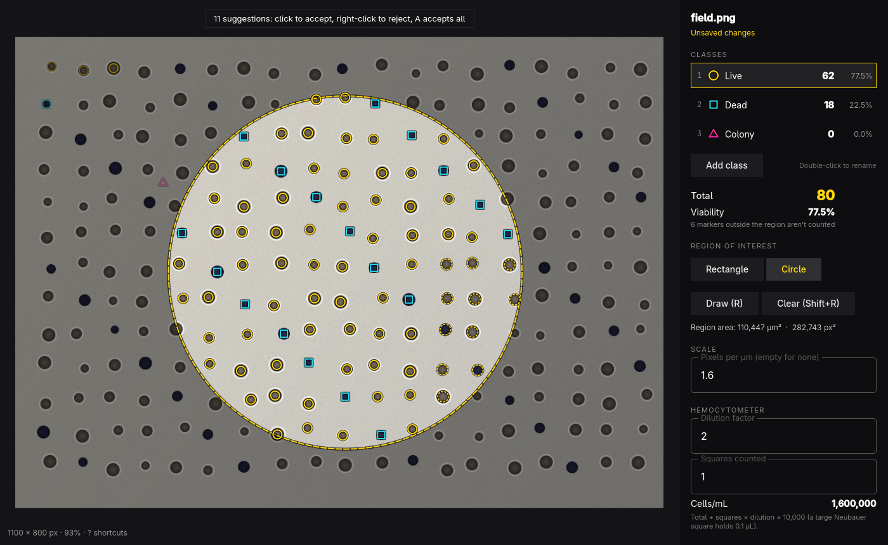

# Cellcount



Count cells or colonies on a microscope or plate image by clicking, and export
the counts. An app for [Omarchy](https://omarchy.org): one window, driven from
the keyboard, following the desktop theme and language.

- Opens PNG, JPEG and TIFF, including 16-bit grayscale TIFF, which is stretched
  for display. The original image is never written to.
- Up to 9 named classes (Live, Dead and Colony to start). Each has its own color,
  starting from the Omarchy accent, and its own marker shape, so classes read
  apart without color.
- A live tally per class with percentages, the total, and viability
  (Live / (Live + Dead)).
- An optional rectangular or circular region of interest. Only markers inside it
  are counted. Its area is shown in px², and in µm² or mm² once you set a scale in
  pixels per µm.
- A hemocytometer helper: enter the dilution factor and the number of large
  squares counted to get cells/mL (total ÷ squares × dilution × 10⁴).
- Auto-suggest finds round spots that stand out from their own surroundings, at
  every size between the smallest and largest cell. It copes with uneven
  lighting, the grid of a hemocytometer, the rim of a plate, dim cells beside
  bright ones, and touching cells. It can look for darker or brighter cells:
  for trypan blue, suggest the brighter (live) cells, then the darker (dead)
  ones. You accept or reject each one, and nothing is counted until you do.
- The session saves as `<image>.cellcount` JSON next to the image, written
  atomically. Export writes a markers CSV (x, y, class), a summary CSV, and an
  annotated PNG drawn by the same painter as the screen.

## Keys

| Key | Action |
| --- | --- |
| Click | Place a marker of the current class under the pointer |
| Drag | Move a marker |
| Right-click / Backspace | Remove the nearest marker |
| 1 – 9 | Pick the class |
| Space | Turn auto-suggest on or off |
| A | Accept all suggestions |
| R | Draw the region of interest (Shift+R clears it) |
| Wheel, + / − | Zoom in and out around the pointer |
| 0 | Fit the image |
| Middle-drag, Space+drag | Pan |
| Ctrl+Z / Ctrl+Shift+Z | Undo and redo |
| Ctrl+O | Open an image or session |
| Ctrl+S | Save the session beside the image |
| Ctrl+E | Export CSV and annotated PNG |
| ? | Show every shortcut |
| Q | Quit (asks first when there are unsaved changes) |

## Command line

None of these commands need a display. Each takes `--json`, exits 0 on success
and 1 on failure, and writes errors to stderr.

```sh
cellcount open [image|session]          # the window
cellcount check plate.tif.cellcount     # validate a session and its image
cellcount summary plate.tif.cellcount   # counts, percentages, area, cells/mL
cellcount detect plate.tif [--threshold N] [--min-area px] [--max-area px] [--polarity auto|dark|light]
cellcount export plate.tif.cellcount --csv markers.csv --summary-csv summary.csv --png annotated.png
cellcount skill install                 # a short skill so coding agents can use cellcount
```

## Session format

```json
{
  "cellcount": 1,
  "image": "plate.tif",
  "imageSize": [2048, 1536],
  "pixelsPerUm": 1.6,
  "classes": [{ "name": "Live", "shape": "circle" }, { "name": "Dead", "shape": "square" }],
  "viability": { "live": 0, "dead": 1 },
  "hemocytometer": { "dilution": 2, "squares": 4, "squareVolumeMl": 0.0001 },
  "roi": { "shape": "circle", "x": 200, "y": 100, "width": 600, "height": 600 },
  "markers": [{ "x": 412.5, "y": 230, "class": 0 }]
}
```

Coordinates are image pixels. The image path is stored relative to the session.

## Build

Cellcount is C++ and Qt Quick, built with `qmake6` and `make`.

```sh
bin/build      # build/cellcount
bin/test       # the Qt Test suite, offscreen
bin/install    # makepkg -fsi, so Cellcount shows up in the app launcher
```

It speaks English, Danish and German, following Omarchy's Setup > Language.
Translations live in `src/i18n/<code>.json`.

The screenshot shows a synthetic image generated by `tests/synthetic.h`. It
contains no real lab data.

## License

MIT
